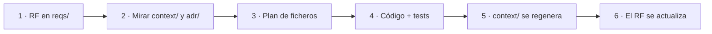

# Documentación de GDG.es

Todo lo que no es código. Cada pregunta tiene **un solo sitio**, para que no haya dos versiones de la
misma verdad.

| Pregunta | Carpeta |
|---|---|
| ¿**Qué** debe hacer el producto? | [`reqs/`](reqs) |
| ¿**Por qué** está hecho así? | [`adr/`](adr/README.md) |
| ¿Con **qué datos y contratos**? | [`context/`](context/README.md) |
| ¿Cómo **encaja** todo? | [`arquitectura/`](arquitectura/README.md) |
| ¿Cómo se **despliega y opera**? | [`tech/`](tech/README.md) |
| ¿Qué exige el **RGPD**? | [`legal/`](legal/README.md) |
| ¿Cómo se **ve**? | [`design/`](design/README.md) |

## El flujo de un cambio

La documentación no se escribe después del código, sino que lo guía:

Reglas completas en [`AGENTS.md`](../AGENTS.md).

## Qué hay en cada carpeta

### [`reqs/`](reqs): requisitos funcionales

Un fichero por requisito, `reqs/<DOMINIO>/RF-<DOMINIO>-NNN.md`, con la plantilla
[`TEMPLATE.md`](reqs/TEMPLATE.md). Ocho dominios, cada uno con un `README.md` índice:

| Dominio | Qué cubre |
|---|---|
| [`SYNC`](reqs/SYNC/README.md) | Importación desde gdg.community.dev (solo España) |
| [`CHAPTERS`](reqs/CHAPTERS/README.md) | Directorio y ficha de capítulos |
| [`ORGANIZERS`](reqs/ORGANIZERS/README.md) | Perfiles de organizadores |
| [`EVENTS`](reqs/EVENTS/README.md) | Agenda y ficha de eventos |
| [`MAP`](reqs/MAP/README.md) | Mapa de capítulos y de eventos |
| [`SPONSORS`](reqs/SPONSORS/README.md) | Sponsors compartidos entre capítulos |
| [`AUTH`](reqs/AUTH/README.md) | Acceso de organizadores y administradores |
| [`ADMIN`](reqs/ADMIN/README.md) | Panel de administración |

Los RF describen **cómo es hoy** la funcionalidad, no su historial (eso está en git).

### [`adr/`](adr/README.md): decisiones de arquitectura

Formato Michael Nygard. Una decisión aceptada no se edita: se reemplaza por otra.

### [`context/`](context/README.md): datos y API

Generado desde el código (salvo el glosario). No se edita a mano.

### [`arquitectura/`](arquitectura/README.md): diagramas C4 y secuencias en Mermaid.

### [`tech/`](tech/README.md): despliegue, sincronización programada, observabilidad.

### [`legal/`](legal/README.md): RGPD de los datos de organizadores.
