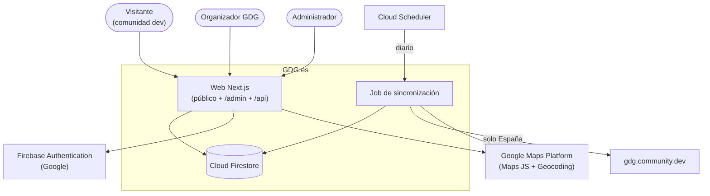
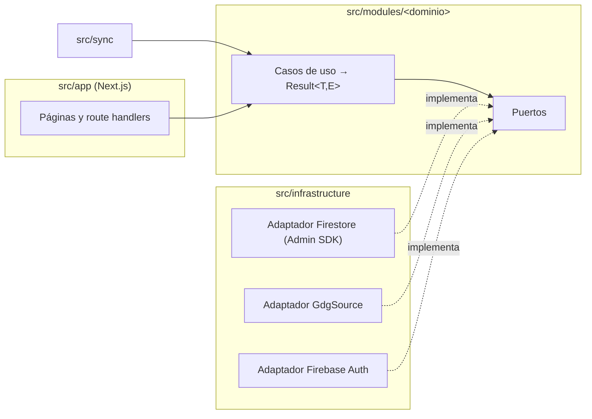
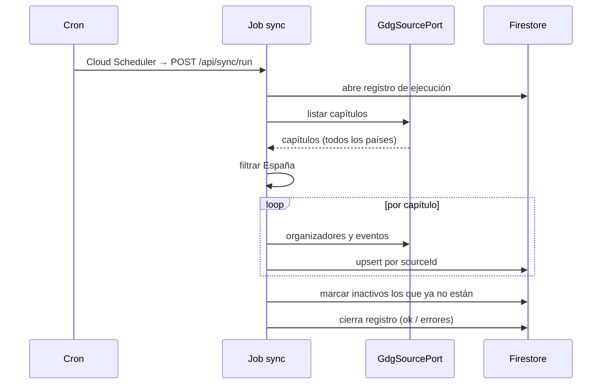
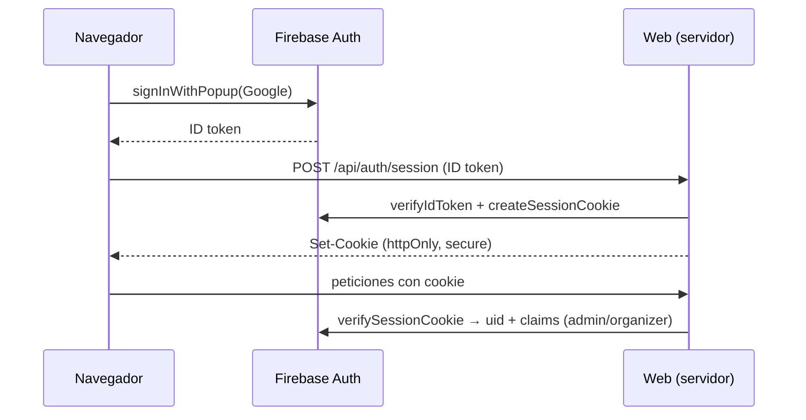

# Arquitectura de GDG.es en diagramas

Diagramas Mermaid de lo general a lo concreto. El *porqué* está en los [ADR](../adr/README.md). Si un
cambio contradice un diagrama, se actualiza en el mismo cambio.

## 1. Contexto (C4 nivel 1)

## 2. Contenedores y capas (C4 nivel 2-3)

## 3. Secuencia de sincronización

## 4. Secuencia de inicio de sesión

