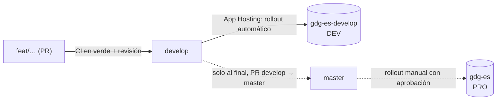

# Despliegue

Decisión en [ADR-0011](../adr/0011-hosting-firebase-app-hosting.md); entornos en [`firebase.md`](firebase.md).

## Durante el desarrollo: solo DEV



- Cada merge a `develop` despliega en **DEV** (rollout automático de App Hosting) y, desde el workflow
  `deploy-dev`, las reglas e índices de Firestore y Storage.
- `master` **no despliega** mientras dure el desarrollo: el backend de PRO no existe o tiene los rollouts
  automáticos desactivados. release-please sigue preparando la versión.
- DEV no se indexa en buscadores (`X-Robots-Tag: noindex`) y muestra un aviso "Entorno de pruebas".
- Los datos de DEV son reales (los importa el sync) pero desechables: se pueden borrar y reimportar.

## Primer despliegue en DEV (manual, desde tu Mac)

Resultado: la web en **https://gdg-es-develop.web.app** (Firebase Hosting reescribe todas las rutas al
backend de App Hosting `gdg-es-web`, Cloud Run en `europe-west4`). También responde en
`https://gdg-es-web--gdg-es-develop.europe-west4.hosted.app`.

Ficheros: `apphosting.yaml` (recursos y variables; sin claves), `firebase.json` (`apphosting` con lo que no
se sube —nunca `.env*`— y `hosting` con la reescritura), `hosting/` (carpeta pública vacía).

Una sola vez:

1. Plan **Blaze** en `gdg-es-develop` (App Hosting lo exige).
2. Crear el backend:
   ```bash
   npx firebase apphosting:backends:create --project gdg-es-develop --backend gdg-es-web --primary-region europe-west4
   ```
   Si pregunta por GitHub, se puede saltar: de momento se despliega desde el código local.
3. Dar a la cuenta de ejecución acceso a Firestore: en IAM de `gdg-es-develop`, a
   `firebase-app-hosting-compute@gdg-es-develop.iam.gserviceaccount.com` el rol **Usuario de Cloud
   Datastore** (`roles/datastore.user`).

Cada despliegue:

```bash
npx firebase deploy --only firestore,apphosting --project gdg-es-develop   # reglas + web (5–10 min)
npx firebase deploy --only hosting --project gdg-es-develop                # web.app → backend (solo si cambia la reescritura)
```

Comprobar: https://gdg-es-develop.web.app/capitulos debe listar los 38 capítulos. Si da error 500, mirar
los registros del backend (consola → App Hosting → `gdg-es-web` → Registros): casi siempre es el rol del
paso 3.

Pendiente: despliegue automático desde `develop` (conectar GitHub en el backend o workflow con WIF) y el
sync programado (Cloud Scheduler).

## Paso a producción (una vez, al final)

Se hace cuando DEV cumple la Fase 4 de `PLAN.md`. Checklist:

1. [ ] Todos los RF "imprescindibles" en verde en DEV y revisión de seguridad hecha.
2. [ ] PRO configurado igual que DEV (checklist de `firebase.md`, columna PRO).
3. [ ] Reglas e índices desplegados en PRO (`firebase deploy --only firestore,storage -P production`).
4. [ ] Backend de App Hosting en PRO conectado a `master`, con rollouts automáticos activados después del
       primer rollout correcto.
5. [ ] Primer sync en PRO y revisión manual de datos (capítulos, organizadores ocultos respetados).
6. [ ] PR `develop` → `master` aprobada; release `v1.0.0` de release-please.
7. [ ] Dominio `gdg.es` apuntado al backend de App Hosting de PRO; el Hosting clásico se retira después
       de comprobar que la nueva web responde.
8. [ ] `legacy/` se borra del repo.

**Vuelta atrás:** App Hosting permite volver al rollout anterior desde la consola; mientras el dominio no
se mueva (paso 7), gdg.es sigue sirviendo la web anterior.

## GitHub

- Environment **`dev`**: sin aprobación; variables `FIREBASE_PROJECT_ID=gdg-es-develop`,
  `WIF_PROVIDER`, `WIF_SERVICE_ACCOUNT`.
- Environment **`production`**: aprobación obligatoria de `@reiaguilera` y solo desde `master`; mismas
  variables con los valores de PRO. Se crea en el paso a producción.
- Son identificadores, no secretos: con Workload Identity Federation no hay claves en GitHub.
