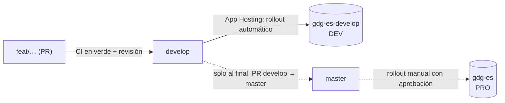

# Despliegue

Decisión en [ADR-0011](../adr/0011-hosting-firebase-app-hosting.md); entornos en [`firebase.md`](firebase.md).

## Durante el desarrollo: solo DEV

- Cada merge a `develop` despliega en **DEV** (rollout automático de App Hosting) y, desde el workflow
  `deploy-dev`, las reglas e índices de Firestore y Storage.
- `master` **no despliega** mientras dure el desarrollo: el backend de PRO no existe o tiene los rollouts
  automáticos desactivados. release-please sigue preparando la versión.
- DEV no se indexa en buscadores (`X-Robots-Tag: noindex`) y muestra un aviso "Entorno de pruebas".
- Los datos de DEV son reales (los importa el sync) pero desechables: se pueden borrar y reimportar.

## Paso a producción (una vez, al final)

Se hace cuando DEV cumple la Fase 4 de `PLAN.md`. Checklist:

1. [ ] Todos los RF "imprescindibles" en verde en DEV y revisión de seguridad hecha.
2. [ ] PRO configurado igual que DEV (checklist de `firebase.md`, columna PRO).
3. [ ] Reglas e índices desplegados en PRO (`firebase deploy --only firestore,storage -P production`).
4. [ ] Backend de App Hosting en PRO conectado a `master`, con rollouts automáticos activados después del
       primer rollout correcto.
5. [ ] Primer sync en PRO y revisión manual de datos (capítulos, organizadores ocultos respetados).
6. [ ] PR `develop` → `master` aprobada; release `v1.0.0` de release-please.
7. [ ] Dominio `gdg.es` apuntado al backend de App Hosting de PRO; el Hosting clásico se retira después
       de comprobar que la nueva web responde.
8. [ ] `legacy/` se borra del repo.

**Vuelta atrás:** App Hosting permite volver al rollout anterior desde la consola; mientras el dominio no
se mueva (paso 7), gdg.es sigue sirviendo la web anterior.

## GitHub

- Environment **`dev`**: sin aprobación; variables `FIREBASE_PROJECT_ID=gdg-es-develop`,
  `WIF_PROVIDER`, `WIF_SERVICE_ACCOUNT`.
- Environment **`production`**: aprobación obligatoria de `@reiaguilera` y solo desde `master`; mismas
  variables con los valores de PRO. Se crea en el paso a producción.
- Son identificadores, no secretos: con Workload Identity Federation no hay claves en GitHub.
